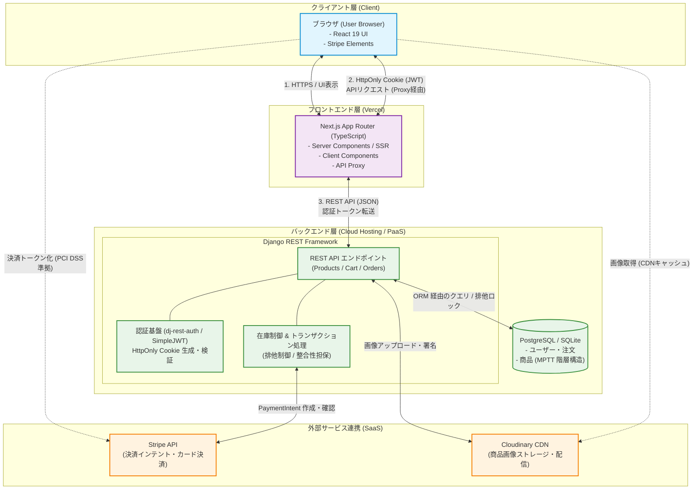

  # フルスタックECプラットフォーム (Next.js × Django REST Framework)


  Next.js (App Router) と Django REST Framework (DRF) を分離構成で構築した、実践的なフルスタックECサイトのポートフォリオです。
  実務を意識した「セキュアな認証設計」「型安全なAPI連携」「在庫排他制御」「E2Eテストによる品質担保」に重点を置いて開発しました。

  ---

  ## 🌐 デモサイト・主要リンク

  - **フロントエンド デモ**: https://e-csite-neon.vercel.app/
  - **API仕様書 (Swagger/OpenAPI)**: https://e-csite-neon.vercel.app/api/docs/


  ---

  ## 🛠 技術スタック

  ### フロントエンド
  - **Framework**: Next.js 15+ (App Router) / React 19 / TypeScript
  - **Styling**: Tailwind CSS v4
  - **State / UI**: React Context API, Sonner (Toast通知)
  - **API連携 / 型生成**: `openapi-typescript` (DRFスキーマからの自動型生成)
  - **決済連携**: Stripe Elements (`@stripe/stripe-js`)
  - **テスト**:
    - ユニット/コンポーネントテスト: Vitest, React Testing Library
    - E2Eテスト: Playwright (Chromium)
  - **ホスティング**: Vercel

  ### バックエンド
  - **Framework**: Python 3.12+ / Django 5.x / Django REST Framework
  - **認証**: dj-rest-auth + django-allauth + djangorestframework-simplejwt (HttpOnly Cookie による JWT 認証)
  - **データベース**: PostgreSQL (本番) / SQLite (ローカル開発)
  - **カテゴリ管理**: django-mptt (階層構造・ツリー構造の最適化)
  - **ストレージ**: Cloudinary (画像・メディア管理)
  - **決済**: Stripe API
  - **APIドキュメント**: drf-spectacular (OpenAPI 3.0 自動生成)
  - **テスト**: Django Test Runner / TestCase (単体・統合・セキュリティテスト)

  ---

  ## 🌟 実装機能一覧

  - **商品関連**
    - 商品一覧・詳細・カテゴリ別絞り込み・検索
    - 商品スペック比較機能 (Compare機能)
  - **ショッピングカート & 決済**
    - カート内商品の数量変更・削除
    - Stripe を用いたクレジットカード決済フロー
    - **注文確定時の在庫排他制御**（同時注文時の在庫不整合防止）
  - **認証 & ユーザー管理**
    - サインアップ・ログイン・ログアウト
    - パスワードリセット（トークン送信フロー）
    - 注文履歴一覧・明細確認
  - **管理機能**
    - Django Admin をカスタマイズした在庫・注文・商品階層管理

  ---

  ## 💎 技術的なこだわり・工夫した点（アピールポイント）

  ### 1. セキュリティを最重視した JWT 認証基盤 (HttpOnly Cookie)
  JavaScript からアクセストークンを直接読み取れないよう、JWT を **`HttpOnly` かつ `SameSite` / `Secure` な Cookie** でやり取りする設計を採用しました。これにより、フロントエンド側の XSS
  脆弱性を突かれた場合でもトークンの窃取を防ぎ、CSRF トークン検証と組み合わせることで強固なセキュリティを担保しています。

  ### 2. スキーマ駆動開発によるフロントエンドの型安全性
  バックエンド（drf-spectacular）から OpenAPI スキーマ（`schema.yml`）を生成し、フロントエンド側で `openapi-typescript`
  を用いて型定義を自動同期しています。これにより、バックエンド側のAPI仕様変更がフロントエンドの型エラーとして即座に検知され、安全で手戻りの少ない開発フローを実現しました。

  ### 3. トランザクションと在庫競合（排他制御）の考慮
  複数ユーザーが同時に最後の1点を決済しようとした場合を想定し、データベーストランザクションおよび適切なロック機構を意識した在庫引き当てロジックを実装。また、Playwright
  を用いて「在庫競合時に適切にエラーハンドリングされ、カート側へフィードバックされるか」のシナリオテスト（`2-stock-conflict.spec.ts`）を自動化しています。

  ### 4. 多層的なテスト構成（Unit / Integration / E2E）
  - **バックエンド**: モデルのバリデーション、注文・決済フロー、認証・権限チェックを網羅した自動テスト（`test_api.py`, `test_auth_security.py`, `test_checkout.py`）。
  - **フロントエンド**: Vitest によるユーティリティ・コンポーネントテストに加え、ユーザーの主要な購買体験（商品閲覧〜決済完了の Happy Path、在庫競合、商品比較）を Playwright で E2E 自動テスト化。

  ---

  ## 🏗 システム構成図



  ---

  ## 🚀 ローカル環境の立ち上げ手順

  ### 前提条件
  - Node.js 20+ (または 24.x)
  - Python 3.12+

  ### 1. リポジトリのクローン
  ```bash
  git clone https://github.com/u2service/ECsite.git
  cd ECsite
  ```

  ### 2. バックエンドのセットアップ
  ```bash
  cd django_ec_backend
  python -m venv .venv

  # Windows の場合
  .venv\Scripts\activate
  # Mac / Linux の場合
  # source .venv/bin/activate

  pip install -r requirements.txt
  python manage.py migrate
  python manage.py runserver 8000
  ```
  *(※必要に応じて `.env` に Stripe APIキーやデータベース設定を記述してください)*

  ### 3. フロントエンドのセットアップ
  ```bash
  cd ../nextjs_ec_frontend
  npm install
  npm run dev
  ```
  ブラウザで `http://localhost:3000` にアクセスしてください。

  ### 4. テストの実行

  - **バックエンドテスト**:
    ```bash
    cd django_ec_backend
    python manage.py test products.tests
    ```

  - **フロントエンド ユニットテスト**:
    ```bash
    cd nextjs_ec_frontend
    npm run test
    ```

  - **E2E テスト (Playwright)**:
    ```bash
    cd nextjs_ec_frontend
    npx playwright test
    ```

  ---

  ## 開発着手前の要件定義・設計仕様書

  [ラーメン店 店内注文・在庫・店舗管理システム 要件定義・設計仕様書](https://github.com/u2service/ECsite/blob/main/docs/%E3%83%A9%E3%83%BC%E3%83%A1%E3%83%B3%E5%BA%97%20%E5%BA%97%E5%86%85%E6%B3%A8%E6%96%87%E3%83%BB%E5%9C%A8%E5%BA%AB%E3%83%BB%E5%BA%97%E8%88%97%E7%AE%A1%E7%90%86%E3%82%B7%E3%82%B9%E3%83%86%E3%83%A0%20%E8%A6%81%E4%BB%B6%E5%AE%9A%E7%BE%A9%E3%83%BB%E8%A8%AD%E8%A8%88%E4%BB%95%E6%A7%98%E6%9B%B8.md)
